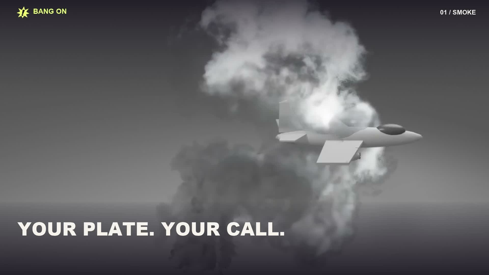

# Bang On

**Big effects. Right on cue.**

Block the action in a lightweight browser simulation. Place smoke or explosions, adjust the wind and lighting, and test holdouts and colliders before spending compute on realism. Generate isolated LTX elements, extract AlphaGen mattes, and take the layers into your comp. Place muzzle flashes on exact firing frames with localized interactive lighting.

**Current release: v1.0.1.** The application code is [MIT licensed](LICENSE). The Python package and command retain the name `keyfx` for compatibility.

[](https://github.com/ProjectFoundary/bang-on/releases/download/v1.0.1/Bang_On_demo_v1.mp4)

[Download/watch the 1:43 demo](https://github.com/ProjectFoundary/bang-on/releases/download/v1.0.1/Bang_On_demo_v1.mp4) · [Get v1.0.1](https://github.com/ProjectFoundary/bang-on/releases/tag/v1.0.1) · [Installation guide](INSTALL.md)

## Install

The [v1.0.1 release](https://github.com/ProjectFoundary/bang-on/releases/tag/v1.0.1) includes a wheel with the interface and editable plane/house examples. Installing the wheel needs Python 3.12, FFmpeg/FFprobe and a WebGL2 browser; Node is unnecessary. Follow [INSTALL.md](INSTALL.md) for macOS/Linux and Windows commands.

For a source checkout, install [uv](https://docs.astral.sh/uv/getting-started/installation/), Node 20+ and FFmpeg, then:

```sh
git clone https://github.com/ProjectFoundary/bang-on.git
cd bang-on
npm --prefix web ci
npm --prefix web run build
uv sync --locked --python 3.12
uv run keyfx serve --port 8765
```

Open **http://127.0.0.1:8765**. The included examples and local simulations work without a Comfy connection. Use **Connect Comfy** to configure your own Comfy Cloud account or local ComfyUI/proxy when you want to generate new results. Weights and model credits are not included.

## Artist workflow

1. **Bring your plate.** Import footage, then generate or provide mattes/depth when interaction is needed.
2. **Direct the action.** Click to place an effect; set size, timing, direction, wind, density and lighting in the browser.
3. **Test interaction.** Use assigned objects as holdouts, colliders, or both. Review the motion and guide locally.
4. **Generate the element.** LTX Fluid creates the isolated RGB; a separate AlphaGen pass supplies its matte. Review and approve each version.
5. **Finish and export.** Refine cached matte/edge/light settings, composite over your source, or export OpenEXR RGBA layers. Add muzzle flashes on the chosen frames.

[Detailed workflow](docs/WORKFLOW.md) · [Model setup](docs/MODELS.md) · [Export options](docs/EXPORT_OPTIONS.md) · [Known limitations](docs/LIMITATIONS.md)

The editable examples include saved generated reference clips. The demo also contains art-directed CG studies made with an experimental renderer; those exact archived results are reference media, not a promise that the editable example will reproduce them unchanged.

## Development

```sh
uv run pytest -q
npm --prefix web run check
npm --prefix web run test:unit
npm --prefix web run build
uv build --wheel
```

See [CONTRIBUTING.md](CONTRIBUTING.md) and [RELEASING.md](RELEASING.md) for changes and future releases. Automated tests use synthetic model transports; they do not demonstrate live provider quality or authorize generation spending.

## License and privacy

Bang On code is released under the [MIT License](LICENSE). Third-party browser components retain their notices in [THIRD_PARTY_NOTICES.txt](THIRD_PARTY_NOTICES.txt). Model weights have their own upstream terms and are not redistributed.

This repository excludes installation credentials, private projects, caches, provider receipts and development footage. The public demo and bundled CG examples are intentional release media. See [SECURITY.md](SECURITY.md) for the local data boundary and reporting guidance.
